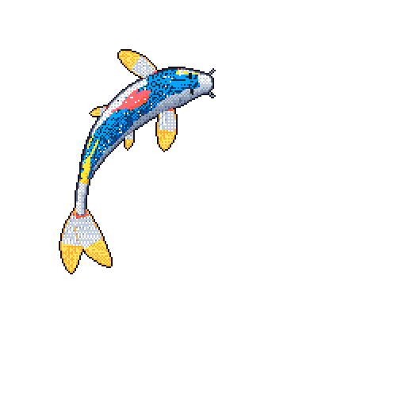

<!--
  Shiridhar Khatri — GitHub Profile README
  Design: Minimal, monochrome, professional
-->

### Building digital products that solve real problems.

Full-Stack Developer · Product Engineer · UI/UX Enthusiast

[Portfolio](https://www.shiridhar.com.np) · [LinkedIn](https://www.linkedin.com/in/shiridharkhatri/) · [Upwork](https://www.upwork.com/freelancers/~01241e90d934b26b94)

 

---

## About Me

I'm **Shiridhar Khatri**, a Full-Stack Developer and independent product builder based in Nepal.

I enjoy taking ideas from concept to production — designing interfaces, engineering backend systems, implementing real-time communication, and managing deployment and infrastructure.

My focus is on building software that is:

- **Functional** — solving actual problems with practical engineering.
- **Fast** — optimized for performance and responsiveness.
- **Thoughtful** — designed with attention to usability and detail.
- **Scalable** — engineered with maintainability and reliability in mind.

I enjoy working across the entire product lifecycle rather than limiting myself to a single layer of development.

---

## What I Do

<table>
<tr>
<td width="50%" valign="top">

### Product Engineering

- Full-Stack Development
- Product Architecture
- Real-Time Applications
- REST APIs & Backend Systems
- Database Design

</td>
<td width="50%" valign="top">

### Design & Infrastructure

- UI/UX Engineering
- Performance Optimization
- Technical SEO
- Cloud & VPS Deployment
- Developer Tools & Automation

</td>
</tr>
</table>

---

## Tech Stack

**Frontend**

**Backend & Databases**

**Infrastructure & Development Tools**

**Creative & Interactive Development**

---

## Featured Projects

### 01 — Chattify

**Real-Time Social Discovery Platform**

Chattify is a social discovery platform designed to help people connect through real-time conversations, random matching, messaging, and community interactions.

**Key Features**

- Random video and text chat
- Real-time matchmaking
- Audio and video communication
- Anonymous confessions and Q&A
- Stories and community interactions
- Media sharing and voice messaging
- AI-assisted safety moderation
- Block, report, and age verification systems
- Android application

**Engineering Focus**

`WebRTC` `Socket.IO` `Real-Time Systems` `Media Processing` `Matchmaking` `Security` `Performance`

---

### 02 — FunTyping

**Arcade Typing & Competitive Gaming Platform**

A cinematic typing platform that transforms traditional typing practice into an interactive arcade experience.

**Key Features**

- Arcade typing modes: Rain, Meteor, Dino & Architect
- Real-time 1v1 typing battles
- WPM and accuracy analytics
- Keystroke heatmaps
- Typing consistency tracking
- Community themes
- Multi-language support
- Programming language typing practice

**Technology**

`Next.js` `React` `TypeScript` `Tailwind CSS` `Framer Motion` `Zustand` `MongoDB` `Socket.IO` `NextAuth` `Three.js` `Lottie`

---

### 03 — ApiX

**API Testing Extension for Visual Studio Code**

A lightweight API testing utility built directly into VS Code, allowing developers to test endpoints without switching applications.

**Key Features**

- REST API requests
- GET, POST, PUT and DELETE methods
- Response inspection
- JSON and HTML response handling
- Image detection and downloading
- Automatic link extraction

---

## Other Projects

| Project | Description |
|:--|:--|
| [AAI Wander](https://aaiwander.com) | Travel and exploration platform focused on modern UX and SEO. |
| [Motive & Momentum](https://motivemomentumco.com) | E-commerce and productivity journal platform. |
| [Fishtail HRMS](https://fishtailhrms.com) | HR, attendance, payroll and workforce management. |
| [DailyWorkReport](https://dailyworkreport.com) | Productivity and daily reporting platform. |
| [Ally Integra](https://www.allyintegra.com) | Business and service integration platform. |

---

## Engineering Interests

<table>
<tr>
<td width="50%" valign="top">

**Real-Time Systems**

WebRTC, Socket.IO, live communication, matchmaking and synchronized interactions.

**Modern Frontends**

React, Next.js, TypeScript, animations and interactive interfaces.

**Backend Engineering**

Node.js, Express, REST APIs, authentication and database architecture.

**Performance Engineering**

Rendering optimization, caching, asset optimization and fast page loads.

</td>
<td width="50%" valign="top">

**Search Engine Optimization**

Technical SEO, structured data, indexing and content architecture.

**Infrastructure**

AWS, Cloudflare, Linux, VPS environments, Docker and deployment.

**Developer Tools**

VS Code extensions, browser extensions and workflow automation.

**AI Applications**

AI-assisted experiences, local models and intelligent product features.

</td>
</tr>
</table>

---

## Currently Exploring

- AI-powered applications and local AI models
- Real-time communication infrastructure
- Browser extensions and developer productivity
- Video and media processing
- Advanced UI interactions
- Automation and open-source utilities
- Performance and infrastructure engineering

---

## GitHub Activity

 

  

---

## Experience

**Full-Stack Developer · 2023 — Present**

Working across the complete software development lifecycle:

`IDEATION` → `ARCHITECTURE` → `DESIGN` → `DEVELOPMENT` → `TESTING` → `DEPLOYMENT` → `OPTIMIZATION`

I enjoy owning products end-to-end, combining engineering, product thinking, design, and infrastructure to deliver production-ready applications.

---

## Let's Build Something

Have an interesting idea, a product to develop, or a challenging engineering problem?

I'm always open to discussing interesting projects and opportunities.

  

**Thanks for visiting my profile.**

*Building things, breaking things, and shipping better things.*

